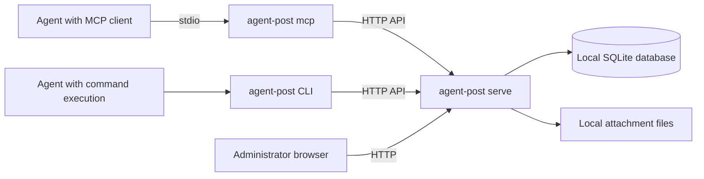

# Proposed architecture

This document describes a design, not implemented behavior. Go, the SQLite driver,
the dependency versions, and the process layout below are proposals. The product
contract belongs to [requirements](requirements.md) and [protocol](protocol.md).
The delivery sequence belongs to the [implementation plan](implementation-plan.md),
and evidence required before claiming support belongs to [acceptance](acceptance.md).

## Process and deployment model

The proposed implementation is one Go executable with three entry surfaces:

| Surface | Responsibility |
| --- | --- |
| `serve` | Run the central HTTP API, browser administration UI, SQLite store, and attachment store. |
| CLI commands | Send, fetch, inspect, and acknowledge through that HTTP API. |
| `mcp` | Serve local MCP over stdio and translate tool calls into the same HTTP API. |

There is one central service process for a data directory. Client machines do not
open the database or mount the service's storage. The service owns all persistent
writes, and clients communicate with it through ordinary HTTP requests.

The initial design does not add a remote MCP endpoint. It also does not include
watch commands, server push, WebSockets, or long polling. Inbox reads return a
bounded result immediately. An agent checks its inbox by calling a tool or CLI
command when its host application permits that call. Connecting an MCP server
does not, by itself, wake an idle desktop application or start an agent turn.

## Proposed implementation components

Use Go's `net/http` for HTTP serving and clients, `html/template` for administration
pages, and `embed` for the UI's HTML, CSS, and JavaScript assets. The initial UI can
use a small amount of browser JavaScript without a frontend framework. The
published executable should contain those assets and should not fetch required
assets from a CDN.

Use `database/sql` with the proposed `modernc.org/sqlite` driver. This driver is
pure Go and avoids cgo. Ordinary local files hold attachment contents; SQLite
holds messages, identities, authorization policy, cursors, receipts, attachment
metadata, and the records needed to recover interrupted operations.

This gives the intended installation a low runtime dependency footprint: the
released executable does not require Node.js, Python, a separate database server,
or an externally installed SQLite library. It still depends on the operating
system, writable storage, and network configuration. Go module dependencies and
their licenses remain part of the source and release supply chain.

The initial administration UI covers metadata, settings, hosts, keys, and health.
It is not a human chat client and does not include a message-body or file-content
inspector.

The CLI, local MCP server, and browser UI must use a common application layer.
Validation, authorization, size checks, and state transitions must not be
reimplemented independently in each interface. HTTP handlers and MCP tools are
adapters around those operations.

## Identity and request admission

An agent has a stable identity separate from the application name, machine name,
and current conversation. Different profiles on one machine are different agent
identities. Two machines with a profile named `default` do not represent the same
agent. A host record represents a machine and may authorize multiple exact IP
addresses. Each agent belongs to a host and receives its own API key.

For an agent request, the service must validate both the agent key and the actual
connection's source IP against that agent's host policy. A sender identity in the
request body is not authoritative. Agent credentials must not authorize another
agent's inbox, receipts, or attachments. Key storage should retain a verification
digest rather than a recoverable plaintext key, and the service must avoid logging
credentials. Key creation and rotation should reveal a new secret only to the
authorized administrator performing that operation.

The source IP comes from the accepted connection, with a documented normalization
rule for IPv4-mapped IPv6 addresses. The first version uses exact address matches,
not subnets, hostnames, reverse DNS, or discovery-based trust. Multiple addresses
may be listed for a host that uses more than one interface.

`X-Forwarded-For`, `Forwarded`, and similar headers are ignored by default. They
must not let a caller select an authorized source IP. A reverse proxy changes the
connection address that the service observes; proxy support must not be described
as preserving the client's IP policy without an explicit future trusted-proxy
design. Direct LAN access is the proposed first-version deployment model.

Administration has a separate authorization boundary. Agent keys are not
administration credentials. The UI and any administrative HTTP operations must
apply the same administrator authentication policy; browser sessions also require
appropriate request-forgery protection. Exact endpoints and credential handling
are specified in the protocol rather than inferred from the transport used.

## Message operations and durable receipts

The central service persists an accepted message before returning an acceptance
receipt for that target. Inbox peek, claim, and acknowledgment are separate
operations. Peek does not change delivery state. Claim leases an unread delivery;
the lease has a token scoped to that delivery, not to a process or session.
Acknowledgment changes a valid leased delivery to read. An expired lease returns
to unread so that it can be claimed again. A fetch proves neither that an LLM
read the content nor that a task was executed. Acknowledgment records the
receiving agent's explicit action; it does not certify the truth of the reply or
the success of work described in it.

Duplicate detection belongs to the server and does not require a client-supplied
unique message identifier or idempotency key. For each target channel, compare a
new submission with that sender's current comparison message while it remains
retained, using the protocol's candidate and equality rules for content and
details. An equal submission is a
duplicate while that comparison message remains retained, with no deduplication
time window. A duplicate does not create another message or attachment copy.

Deduplication evidence belongs to retained message state. Delete it when its
message is evicted, so identical content may be sent again afterward. This
contract is narrower than indefinite retry idempotency: a later message or
retention change can change the comparison candidate. The implementation must
not promise permanent exactly-once sending from this content-comparison rule.

Inbox access uses bounded, immediate fetches with the protocol's cursor and
ordering rules. Persistent message state and explicit acknowledgments support
recovery after a client is offline. The design must not rely on an in-memory event
queue or an open network connection to preserve a message. Automatic execution
inside third-party agent applications is outside this transport layer.

Text length and file size limits are configurable application constraints. Count
body length in Unicode code points; reject an oversized body in full with the
current limit instead of truncating or splitting it. A message has text alone or
text with at most one file. File size is measured in bytes. Limits must be checked
consistently before a target can receive a success receipt. HTTP body limits are
additional resource controls and must allow the encoding overhead of an otherwise
valid operation.

One global set of settings applies to all channels, while every DM channel and
group counts its own retained messages and files independently. Message-count
and file-count eviction removes the oldest records. Deletion is coupled in both
directions: deleting a message deletes its file, and evicting a file deletes the
message carrying it. Reducing limits applies retrospectively, including bodies
and files that are now oversized. Unread or leased state does not protect a
message from eviction, and acknowledgment does not extend retention. An ACK for
an evicted delivery cannot restore it.

## Fan-out and independent ownership

A direct-message fan-out request is an operation over several target DM channels.
Every successful target receives its own message record and message identifier.
The response reports the outcome for each target, so acceptance for one target
does not imply acceptance for every target. An invalid target must not block a
valid target. Duplicate detection is evaluated independently for each target
against its retained comparison message, including when a caller retries a
partially successful request.

Every successful target also owns an independent physical copy of its optional
attachment. An upload may arrive once into a temporary staging area, but it is
then materialized as a separate ordinary file for every successful target
channel. Staging is an input optimization, not a shared permanent object store.

The first version must not replace these copies with shared content-addressed
objects, hard links, reflinks, or a shared reference-counted attachment record.
Equal hashes may verify content integrity; they do not imply shared ownership.
Deleting or expiring a message or channel can remove only that target's message
and files. It must not cascade through a fan-out parent or a shared attachment
lifecycle and affect another successful target.

Materialization has a measurable storage cost: sending a file to N successful
channels requires N independently owned copies, plus temporary staging while the
operation is in progress. Admission and disk-space handling must account for
that cost. A group message is one message in one group channel: it has one owned
copy of its optional file, not a separate physical copy for each group member.
Group members' deliveries and leases remain independent of that group message.
Any later storage optimization needs a new design decision preserving the
ownership contract.

Staging is internal to a message submission. The first version does not expose a
public upload-only operation or a reusable staged-file handle. Text-only direct
messages use JSON; a direct message with a file uses one multipart submission
containing the metadata and file, as defined by the protocol.

## Group metadata and membership

A group has an owner and invitation-based membership. Membership states are
pending, active, and left. Creating the group records its name and invitees;
invitation administration belongs to the owner. Join and leave are explicit
operations. The initial contract does not include kicking a member.

An owner cannot leave while retaining an ownerless group. The initial
implementation may return `owner_cannot_leave` until an administrator resolves
ownership or dissolution; owner transfer and group dissolution need the exact
protocol semantics before they are offered. Membership and group metadata do
not change the independent ownership of another channel's messages or files.

## Database and filesystem consistency

SQLite transactions and filesystem operations do not form one atomic transaction.
The implementation must make that boundary explicit. For each target, it should
prepare the target's attachment copies, validate their lengths and hashes, make
them durable under the selected durability policy, and commit their metadata and
message together before reporting success. Temporary paths must not be exposed
as successful attachments.

An interruption before the metadata commit may leave an unreferenced target file;
an interruption after the commit must not leave an acknowledged message pointing
to an incomplete file. Durable operation records and startup reconciliation must
distinguish staging, prepared copies, committed ownership, and deletion work.
Cleanup must be scoped to its owning target and must never follow a shared
fan-out reference into another target's files.

A purge immediately revokes logical access in the database, deletes the message
payload and its deduplication evidence from application records, and records
durable file deletion work in the same transaction. No soft-delete archive keeps
the body available for recovery. A deletion job retains only opaque internal
paths, not message bodies or attachment contents. Physical unlink happens through
recoverable work: an interruption or failure leaves visible pending or failed
cleanup, rather than a claim that bytes have already been removed. Failed
physical cleanup blocks new attachment writes until the failure is resolved.
Metadata-only operations do not imply that physical cleanup has completed.

File paths are generated by the service from internal identifiers. Client file
names are display metadata and cannot select paths. Upload and download streams
need bounded resource use, size enforcement during transfer, and authorization
before exposing stored content. The download path must not accept arbitrary
filesystem paths or URLs supplied by a peer.

## SQLite concurrency and durability

The database resides on a local filesystem on the central service host. SQLite
WAL is a proposed configuration, not a distributed storage mechanism. Do not put
the live data directory on SMB, NFS, or a folder synchronized between machines.
WAL supports concurrent readers and a writer, but still permits only one writer
at a time.

The implementation should serialize writes through a bounded writer path, keep
transactions short, bound the read connection pool, configure busy handling, and
observe checkpoint behavior. Immediate inbox requests must close their database
transactions promptly. Attachment copying must not hold a database write
transaction open for the duration of a large transfer.

`synchronous=FULL` is the proposed baseline when a successful receipt is expected
to survive power loss. The final guarantee also depends on the operating system,
filesystem, storage hardware, and the implemented file durability sequence.
Changing to a weaker policy requires explicit documentation and separate
acceptance results. The initial service does not keep an automatic content backup
or recovery archive of discarded messages and files. Agents save important
content themselves. Deletion does not imply cryptographic erasure of storage
remnants; the immediate guarantee is application revocation followed by visible,
recoverable physical file cleanup.

The 100 requests/second figure is a planned load-test target for ordinary API
operations, including checks, claims, ACKs, directory reads, and ordinary text
messages. File-transfer throughput is measured separately. The figure is not a
fixed rate cap, a measured result, or a capacity guarantee. Tests must name the
hardware, request mix, message sizes, fan-out width, competing attachment activity,
durability policy, and latency distribution before a performance claim is made.

## Failure and trust boundaries

Network failures may hide the result of an already accepted request. Explicit
receipts and retained-message content comparison help resolve that ambiguity
within the protocol's limits; they do not create an indefinite exactly-once
guarantee. Client unavailability leaves persisted messages available for a later
fetch while retention permits. A service restart must recover committed messages
and reconcile interrupted file operations without treating history as an
instruction to reexecute work automatically.

Messages and files are peer-supplied content. The messaging service does not turn
them into shell commands, operator commands, or trusted system instructions.
Agents decide how to use received content under their own application's policy.
Loop prevention and task delegation behavior remain distinct from reliable
message storage.

## Candidate evidence

The following primary sources support the proposed implementation route. They do
not establish that this repository has implemented or tested it.

- [Go `embed`](https://pkg.go.dev/embed): embeds assets at compile time.
- [Official MCP Go SDK](https://github.com/modelcontextprotocol/go-sdk): provides
  local stdio and HTTP transports; this design initially uses its stdio surface.
- [modernc SQLite driver](https://pkg.go.dev/modernc.org/sqlite): documents the
  pure-Go driver, platform matrix, dependency considerations, and license.
- [SQLite WAL documentation](https://www.sqlite.org/wal.html): describes the
  single-writer model, local-host restriction, checkpoints, and durability tradeoffs.
